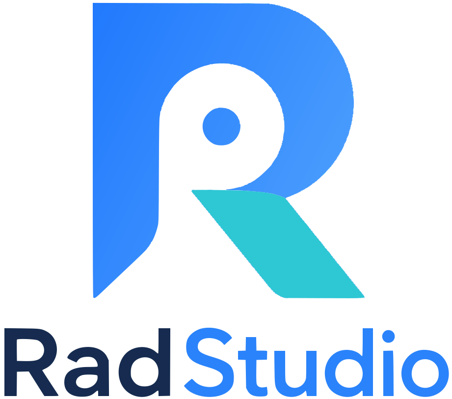
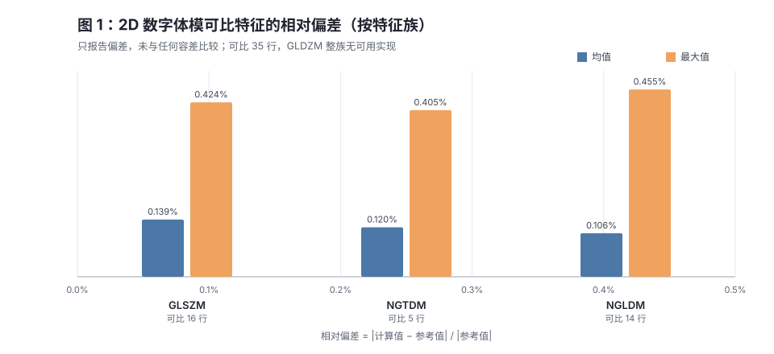
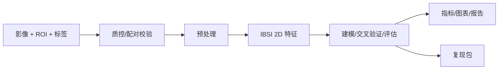

<div align="center">



# RadStudio Local

**把影像组学论文变成可复现的本地工作流。数据不出院，结果可核对。**

[](https://github.com/RadStudioTeam/RadStudio-Local/actions/workflows/sdk-ci.yml)
[](https://github.com/RadStudioTeam/RadStudio-Local/releases)
[](LICENSE)
[](https://www.python.org/)

[快速开始](#5-分钟跑通) · [为什么开源](#为什么做-radstudio-local) · [路线图](#路线图) · [English](#english)

</div>

> **状态**：`v0.2.0`（Python SDK / 单机 runner / CLI / **本地 Web UI** / IBSI 2D 复现包）。
> **范围**：仅供科学研究与教学，**不用于临床诊断，不构成医疗器械**。

---

## 为什么做 RadStudio Local

影像组学研究的真实日常，往往不是「缺一个算法」，而是：

- 脚本散落在不同人的电脑里，参数只存在聊天记录里；
- 换台机器、换个库版本，特征值就对不上；
- 论文要交可复现材料，却只能给一堆截图和 Excel；
- 医院数据不能出院，云端工具再好也用不了。

RadStudio Local 把「数据 → 质控 → 预处理 → IBSI 特征 → 建模 → 评估 → 报告/复现包」冻结成一条**可重跑的工作流**：

| 你得到的 | 具体是什么 |
| --- | --- |
| **数据不出本机** | 本地执行，默认不上传、无遥测；适合院内/课题组数据合规要求 |
| **可复现** | 输入 SHA-256、算子版本快照、参数、环境、产物全部留痕；复现包可独立重跑 |
| **可核对** | 内置 IBSI 2D 数字体模自检：54 行逐特征偏差，按族汇总，**不伪造 pass/fail** |
| **可移植** | 工作流是版本化 JSON（Workflow IR），本地与云端之间可导入/导出 |
| **可扩展** | 按统一契约写 Python 自定义算子，本地调试通过后可带到云端 |

> 这不是「又一个 PyRadiomics 脚本封装」。它解决的是**科研流程的可追溯与可交接**：同一份工作流，任何人、任何机器，都能核对它是怎么算出来的。

## 5 分钟跑通

不需要真实患者数据，用 IBSI 官方数字体模验证整条链路：

```bash
git clone https://github.com/RadStudioTeam/RadStudio-Local.git
cd RadStudio-Local
bash reproductions/p1-ibsi-2d/reproduction/run.sh
```

首次会按 `uv.lock` 建环境（PyRadiomics 需本地编译，约 3–10 分钟）。成功后得到：

| 产物 | 内容 |
| --- | --- |
| `07-comparison.csv` | 54 行逐特征偏差（no_tolerance 35 + not_comparable 19） |
| `07-comparison_by-family.csv` | GLSZM / NGTDM / NGLDM / GLDZM 按族汇总 |
| `run-summary.json` | 节点、参数、输入哈希、Python/PyRadiomics 环境 |

**口径说明**：数字体模的参考值没有公布容差，所以本项目只产出偏差，不产出「通过 IBSI」的结论；有容差的 350 行来自 CT 配置 A/B，不在本包范围。详见 [`reproductions/p1-ibsi-2d/README.md`](reproductions/p1-ibsi-2d/README.md)。

<p align="center">
  
</p>

### 跑自己的数据（CLI）

```text
my-study/
├── data/
│   ├── images/       # case1.png, case2.png, ...
│   ├── masks/        # 与图片同名；也支持同目录 _mask 后缀
│   └── labels.csv    # sample_id,label[,patient_id]
└── workflow.json     # Workflow IR，或云端导出的 workflow.json
```

```bash
cd packages/python-sdk && uv sync
uv run radstudio doctor                                   # 检查环境
uv run radstudio run workflow.json --data ./data --out ./out
uv run radstudio report ./out --open                      # 静态 HTML 报告
```

每次运行都会留下 `_inputs/request.json`、`events.jsonl` 与 `manifest.json`，便于复核与复跑。完整参数见 [docs/cli.md](docs/cli.md)。

### 本地 Web UI（v0.2，推荐给不写代码的用户）

```bash
uv run radstudio ui --workspace ~/RadStudioLocal
```

浏览器打开 <http://127.0.0.1:8765>，五个页面完成：**数据扫描 → 选模板/改参数 → 运行 → 看指标/图 → 导出报告**。单用户、离线、只监听本机；不需要命令行。

| 页面 | 能做什么 |
| --- | --- |
| 数据 | 扫描本机目录，校验图片/掩膜/标签配对 |
| 工作流 | 选模板、编辑 JSON、改 ReadImages 参数、只读 DAG |
| 运行 | 后台启动、进度/事件/日志、取消 |
| 结果 | 指标、图表、产物清单、静态报告 |
| 设置 | 工作区与默认数据目录 |

详见 [docs/ui.md](docs/ui.md)。需要拖拽编辑/协作/GPU 时用云端版。

## 你能用它做什么



- **影像组学特征**：IBSI 2D 一阶/形状/纹理特征，参数与口径可查；
- **建模与评估**：分组交叉验证、OOF 评估、ROC/混淆矩阵/Brier 等指标；
- **复现与交接**：一次运行导出输入清单、算子快照、产物与复现脚本；
- **自定义算法**：按 `operator-schema` 写 Python 算子，本地调试、版本固定；
- **教学与演示**：合成体模 + 公开案例，不碰患者数据也能讲完整链路。

## 适合谁

| 人群 | 典型用法 |
| --- | --- |
| 影像科医生 / 医学生 | 复现论文方法、生成特征表/指标/图，写进论文材料 |
| 课题组 / 实验室 | 统一流程与版本，学生毕业/交接时不丢参数 |
| 生信 / 影像 AI 工程师 | 用 SDK 与 Workflow IR 搭建、扩展、集成自己的算子 |
| 高校教师 | 用合成体模与公开案例做课程/工作坊，无需数据审批 |

**不适合**：把输出当诊断结论、需要多人在线协作、需要 GPU 集群或开箱即用图形界面（这些在云端版/路线图中）。

## 本地免费，云端省事

开源版不限制功能，只限制「规模与协作」：

| 能力 | RadStudio Local | 云端 RadStudio |
| --- | --- | --- |
| 影像组学 CPU 链路、复现、导出 | ✅ 免费 | ✅ |
| 自定义算子本地开发 | ✅ | ✅ 网页 IDE |
| 数据管理 / 团队协作 / 权限 / 审计 | — | ✅ |
| GPU / 深度学习 / 大规模并行 | — | ✅ |
| AI 助手 / 自动编排 / 数据广场 | — | ✅ |
| 本地 Web UI（数据/模板/运行/结果） | ✅ 单用户五页 | ✅ 完整工作台 |

需要可视化编排、GPU 训练或团队协作时，把本地导出的工作流带到云端：

**[→ 了解云端 RadStudio](https://radstudioi.com/?utm_source=github&utm_medium=readme&utm_campaign=oss_launch)** · **[→ 进入工作台](https://app.radstudioi.com/?utm_source=github&utm_medium=readme&utm_campaign=oss_launch)**

> **为什么开源**：可复现的本地能力应该是科研基础设施，而不是某家平台的锁定。我们开放格式、SDK 与本地执行；云端负责算力、协作与 AI。你随时可以把工作流与复现包带走。

## 为什么可信

- **CI 全绿**：每次提交在 Python 3.11/3.12 上跑 lint、pytest、JSON Schema 校验，并真实执行 IBSI 2D 自检（[workflow](https://github.com/RadStudioTeam/RadStudio-Local/actions/workflows/sdk-ci.yml)）。
- **口径诚实**：数字体模不产出一致率；已知波动、不可比原因逐条写在复现包里。
- **数据干净**：仓库只含合成体模与公开数据；贡献指南禁止患者数据/PHI。
- **许可清晰**：代码 Apache-2.0；IBSI 数据 CC BY 4.0（署名见 [NOTICE](NOTICE)）；名称与 Logo 商标保留（[TRADEMARK.md](TRADEMARK.md)）。

## 仓库结构

```text
packages/python-sdk/     SDK、runner、算子、执行契约与测试
packages/*-schema/       Workflow IR / Operator / Event / Artifact / Analysis JSON Schema
packages/compliance/     IBSI 2D 数字体模与参考值（CC BY 4.0）
reproductions/           P1 IBSI 2D 复现包（输入哈希、产物、已知波动）
examples/                自定义算子示例（Brier Score）
docs/                    快速开始、执行契约（docs/workflows/）、本地算子开发
```

## 路线图

| 版本 | 内容 | 状态 |
| --- | --- | --- |
| `v0.1.0-beta` | SDK / runner / IBSI 2D 复现包 / Schema / 本地算子指南 | ✅ 已发布 |
| `v0.1.1` | `radstudio` CLI（run / replay / report / doctor）、静态报告、预构建 Docker 镜像 | ✅ 已发布 |
| `v0.2.0` | **本地 Web UI**：数据/工作流/运行/结果/设置五页，只读 DAG，静态报告（单用户） | ✅ 已发布 |
| `v0.3.x` | Windows 便携包、模板库、更多公开复现案例 | 计划 |

不在路线图：临床诊断、医疗器械注册、多用户私有化部署、患者数据托管。

## 常见问题

<details>
<summary><b>需要把数据上传到哪里吗？</b></summary>
不需要。开源版默认本地执行，不上传、无遥测；数据目录由你自己管理。
</details>

<details>
<summary><b>和云端版是什么关系？</b></summary>
同一套 Workflow IR 与算子契约。本地免费、可复现；云端提供可视化工作台、GPU、协作、AI 与数据广场。工作流可双向导入/导出。
</details>

<details>
<summary><b>能用于临床诊断吗？</b></summary>
不能。本项目仅用于科研与教学，不构成医疗器械，输出不能作为诊断依据。
</details>

<details>
<summary><b>现在有图形界面吗？</b></summary>
有。v0.2 提供本地 Web UI：`radstudio ui --workspace ~/RadStudioLocal`，浏览器完成数据/模板/参数/运行/结果，单用户、只读 DAG。拖拽编辑与协作仍在云端。
</details>

<details>
<summary><b>支持 Windows 吗？</b></summary>
源码路径支持 Python 3.12 + uv；预构建 Docker 镜像与 Windows 便携包在后续版本提供。当前建议 Linux/macOS 或 Docker Desktop。
</details>

<details>
<summary><b>可以商用或二次开发吗？</b></summary>
代码 Apache-2.0，可自由使用/修改/分发；名称与 Logo 商标保留（见 [TRADEMARK.md](TRADEMARK.md)）；云端服务与私有化支持另议。
</details>

## 参与贡献

- 发现 Bug / 想要功能：[开 Issue](https://github.com/RadStudioTeam/RadStudio-Local/issues)
- 贡献算子、复现包、文档：先看 [CONTRIBUTING.md](CONTRIBUTING.md)（DCO，无需 CLA）
- 安全问题：按 [SECURITY.md](SECURITY.md) 私下报告，不要开公开 Issue
- 觉得有用？**Star** 一下，是我们持续投入开源的最大动力 ⭐

## 引用与许可

- 学术引用：见 [CITATION.cff](CITATION.cff)；复现包请同时引用 IBSI 原始论文。
- 代码：Apache-2.0；文档：CC BY 4.0；IBSI 数据：CC BY 4.0（见 [NOTICE](NOTICE)）。
- 商标与品牌使用边界：见 [TRADEMARK.md](TRADEMARK.md)。

## 免责声明

本项目仅用于科学研究与教学，不构成医疗器械，不用于临床诊断。使用者需自行确保数据已脱敏并符合机构伦理与数据使用许可。

---

## English

**RadStudio Local** is an open-source, local-first toolkit for reproducible radiomics research. Run the same workflow and operators on your own machine; every run records input hashes, operator snapshots, parameters and artifacts, so results can be audited and replayed. Data stays local by default.

```bash
git clone https://github.com/RadStudioTeam/RadStudio-Local.git
cd RadStudio-Local
bash reproductions/p1-ibsi-2d/reproduction/run.sh
```

- License: Apache-2.0 (code), CC BY 4.0 (docs/IBSI data)
- Scope: research and education only; **not a medical device, not for clinical diagnosis**
- Local web UI is on the roadmap (2027-01); cloud edition offers GPU, collaboration and AI

If this project helps your research, please cite it via [CITATION.cff](CITATION.cff) and star the repo.
